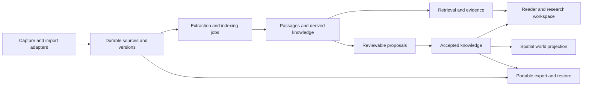

# Worldview workspace update proposal

Prepared November 22, 2026. Status: researched implementation proposal; application changes have not been made. Evidence and competitor sources: [research report](WORKSPACE-UPDATE-RESEARCH.md).

## Recommendation

Build a dependable personal knowledge workspace around a durable record of the user's thinking. Capture should work immediately; useful organization should arrive progressively; every answer and inferred connection should lead back to evidence. The 3D world remains a first-class way to explore the same knowledge and revisit its history.

The current implementation invests deeply in embodiment, simulation and navigation while importing, reading and reusing the record remain fragmented. Another visual reset will not resolve those workflow gaps. Reuse the working storage, local capture, originals, archive recovery, spatial contracts and integer engine; strengthen the knowledge system underneath and give daily work a readable interface.

This proposal preserves the [governing XYZ-space/history amendment](PLAN.md#current-product-amendment--xyz-space-history-as-the-fourth-dimension-2026-11-04). Recommended new default: Today on first launch, then restore the user's last workspace, including Explore. This default remains a product recommendation for implementation.

### Confirmed problem scope

The user confirmed that all three areas are failing: capturing and organizing material, finding and using saved knowledge, and the spatial interface/daily workflow. All three are required outcomes of this update. That confirmation establishes the scope; the code audit identifies likely causes without claiming every existing feature is broken.

Treat the rebuild as one connected experience. Early milestones produce demonstrable foundations, while acceptance of the replacement workspace requires the complete capture, organization, retrieval, reading and spatial exploration loop. Spatial usability work starts with the shell and navigation; deeper semantic neighborhoods follow once their evidence exists.

## What success looks like

The user can bring in a conversation archive, continue thinking normally, and later ask what they decided, find the original wording, follow related ideas, resume an unfinished project and see how their view changed. Saving a thought does not require choosing a category, navigating 3D or configuring a model. Every source remains useful when AI is unavailable.

Five representative journeys govern delivery:

1. Import a chat export or vault; see a receipt with complete/failed/excluded counts; import it again without duplicates.
2. Ask “What did I decide about this last month?”; get a scoped answer with citations that open the exact turns or passages.
3. Open Today; continue a recent line of work, capture a thought or voice memo, and see relevant existing material.
4. Review a proposed connection or belief; inspect supporting and conflicting passages; correct the interpretation without changing its source.
5. Open Explore from a question, topic or record; understand why nearby items are related; change the history date without rearranging spatial anchors.

## Product structure

| Workspace | Primary job | Essential behavior |
|---|---|---|
| Today | Capture and resume | One capture field; recent work; open questions; processing status. No mandatory daily ritual. |
| Search / Ask | Find and investigate | Full-text and semantic results, source/date/author/type filters, selected-source scope, evidence-backed answers. |
| Library | Read and manage | Sources, conversations, notes and attachments; reader with original, interpretation and revision history. |
| Projects / Topics | Keep context together | Saved collections, pinned questions, decisions and unresolved threads. Collections can be manual or query-based. |
| Explore | Spatial discovery | Existing embodied records, stable XYZ neighborhoods, focused relationship views and independent history playback. |
| Review | Correct the system | Proposed merges, assertions, date corrections and important relationship changes; accept, edit, reject and undo. |
| Sources / Activity | Understand capture | Import receipts, connector status, exclusions, retries, real jobs, AI usage and backup health. Settings stays accessible here. |

Today, Search and Library render without WebGL. Load the world only in Explore and suspend its GPU work when hidden. Search, reader, timeline and world share one query/selection state: source IDs, collection, text, author, date interval and selected record. A citation must preserve context when opened, and returning from Explore must restore the investigation.

Keep familiar navy/silver surfaces and readable typography during the functional work. Replace repeated floating dialogs with stable routes and a source reader. On narrow screens, use one main surface with a back path; mobile capture and reading come before 3D navigation. Accessibility includes keyboard operation, visible focus, reduced motion and equivalent textual access to graph relationships.

## Data and architecture

### A durable source record

Add entities alongside existing contracts rather than renaming/removing `NodeRecord` fields:

| Entity | Required information |
|---|---|
| Source | UUID, source kind, provider/account scope, external identity or canonical path, ownership/authorship setting, AI policy, exclusion state. |
| SourceVersion | UUID, source ID, content hash, original blob reference, capture time, source time with precision/timezone if known, parser version, previous version. |
| Conversation / Message | Stable external message IDs, thread and branch/parent IDs, role, author attribution, timestamp, text and attachment references. Unknown authorship stays unknown. |
| Passage | Version/message ID, text offsets and locator: page, paragraph or audio/video time. Quotes verify against a retained version. |
| DerivedArtifact | Summary, tag, entity mention, assertion or relationship; evidence passage IDs; extraction run/model/schema; proposed/accepted/rejected state. |
| AssertionRevision | Wording, attributed speaker, validity interval when supported, evidence, supersession and user correction history. |
| ImportRun / JobRun | Input identity, parser/model versions, item outcomes, checkpoint, retries, cost/usage and error details. |
| Collection / ViewState | Manual membership or saved query, source scope, selected items and resumable reading position. |

`NodeRecord` remains the render/edit projection used by existing modules. Its six archetypes describe embodiment, while new semantic roles such as concept, person, project, question, decision and belief belong to the knowledge layer. A source or message does not automatically become a separately rendered world object. This prevents a 100,000-turn import from flooding the scene.

All edits use one validated command layer. Editing a user-authored note creates its authoritative source revision; editing an interpretation creates a knowledge revision. The same command refreshes the `NodeRecord` projection. Import backfills and regeneration must preserve user corrections, UUIDs and semantic pins rather than overwrite them from a second editable copy.

Originals are immutable within a version: edits create another version. Explicit deletion/exclusion must still remove affected material from retrieval and derived projections; historical retention is not a promise to retain deleted content forever. A user statement, a quotation from someone else and an assistant suggestion must remain distinct. Repetition or confident model output never establishes that the user believes an assertion.

### One authority per workspace

Use the existing SQLite engine as the preferred desktop/local-service authority for corpus metadata, source-version text and job state, with content-addressed original blobs on disk. Search indexes and embeddings are rebuildable. Retain the IndexedDB adapter during migration and for standalone browser use; feature availability must be explicit where a local service is required.

SQLite stores authoritative version snapshots; optional app-managed Markdown exports/mirrors provide portability. An external vault initially remains a read-only imported source: detect its edits as new source versions. Do not introduce simultaneous two-way filesystem and database writes without a conflict protocol. A watched path is not a stable identity on rename: use known provider IDs or a source registry; ambiguous moves require reconciliation rather than unsafe hash-based merging.

Existing hosted accounts remain a separate deployment mode. A browser talking to a hosted SQLite server is not equivalent to a fully offline local app. Keep current data in place until an explicit migration copies and verifies it. Multi-device offline writes, conflict resolution and encrypted sync are a later milestone, not an implied consequence of adding a desktop window.

### Capture and repeatable ingestion

Commit the original bytes and import receipt before any model call or “saved” acknowledgment. Then parse, extract text, index and optionally enrich. Unsupported formats remain downloadable with an honest unindexed status. No provider outage, exhausted budget or failed transcription may discard a saved original.

Initial adapters: local text/Markdown and attachments, structured ChatGPT and Claude exports, and repeatable Obsidian folder import. Preserve all recognized turns/roles/times/branches; retain unsupported fields in original data. Add Gemini and local coding-session adapters after schema fixtures exist. A browser file picker supports manual folder refresh; continuous watching requires the local service/desktop permissions. Cloud services, browser extensions and mobile share capture each need an actual connector and declared scope.

Idempotency uses `(source scope, external item ID, source revision/content hash)`. Preserve app UUIDs across updates. Cross-source hash matches can suggest duplicates but must not erase independent provenance. Imports run in bounded batches with item receipts and resume checkpoints. Distinguish ingestion into the corpus from legacy archive replacement; a source import must never wipe the world.

Show counts for discovered, saved, parsed, indexed, enriched, excluded and failed items. Reconcile attachments by source identity/full path and hash, not basename alone. A failed attachment remains an explicit failed item with retry.

### Retrieval that can read the evidence

First fix the immediate tool gap: extend search results with useful excerpts and add bounded read-record/read-source tools. Then build passage retrieval across complete supported source text, including attachments and late document sections.

Use SQLite full-text retrieval plus the existing local vector capability; combine ranks and add reranking only when evaluation shows benefit. Chunk by document/message structure with overlap and exact locators. Record embedding model, dimensions and version so incompatible indexes cannot be mixed. Unsupported or unindexed sources must be visible in answer coverage.

Filter permissions, exclusions, authorship and selected source scope before retrieval; recheck before returning context. Citations include stable source version/message/passage identifiers and open the reader at the evidence. Reject fabricated citation IDs. An answer should distinguish supported conclusions, inference and missing evidence. General model knowledge and web research must be clearly separate from the personal record.

Do not select a new model or graph database during planning. Keep existing pinned dependencies; any implementation dependency requires a recorded reason in DECISIONS.md and compatibility checks. Long-term graph concepts can start in SQLite tables and queries.

### Organization and real jobs

Introduce basic durable import/extraction jobs in milestones 2–3, then extend them to enrichment and review in milestone 4. Jobs cover parsing, text extraction, transcription, embedding, tag/entity proposals, relationships and collection summaries. They need idempotency keys, leases/checkpoints, bounded retries, cancellation, pause, progress and recorded outputs. Model calls use per-source local/cloud policy and configurable spend limits. Provider failure leaves the durable record intact.

Low-risk derived tags and topic suggestions can appear automatically with provenance and undo. Proposed entity merges, asserted beliefs, significant date corrections and contradictions appear in Review before they alter accepted knowledge. Use “possible disagreement” until supported by context; a question or quotation is not a belief. User corrections become explicit constraints for future runs.

Existing query agents retain their useful saved-query behavior. Their avatars may display actual queued/running/completed jobs when the job system exists, with links to outputs. Motion alone must not imply a task was performed. Start agent interoperability with narrow read-only search/read/citation capabilities; later mutation tools use the same validated command and revision system as the UI. No automatic external messaging is part of this update.

### Space and time

Preserve WebGL2, one SparkRenderer, integer reversibility and the shared pose table. Dates must not become elevation again. Keep semantic pins as explicit user intent; never persist integrator positions/velocities.

Build topic/entity/claim neighborhoods from accepted relationships and local content signals, with stable IDs and incremental layout. Projection coordinates are an aid to exploration; do not label Euclidean distance as conceptual truth. Show “why related” and distinguish saved relationships from inferred suggestions. Offer small, question-centered subgraphs as well as whole-world navigation. Preview any global regrouping and preserve pins.

Keep these times separate: source authored time, capture/recorded time, claimed event time and assertion validity. Preserve unknown precision. Existing `temporalOrigin` continues to govern world births according to the current contract. Add source activity and content-revision/belief history separately; scrubbed births are not a reconstruction of old wording. A future history view can select version state explicitly without changing spatial semantics.

### Privacy, durability and scale

Expose separate controls for original storage, local inference, remote inference, sync, backups and telemetry. Distinguish exclusion from corpus/search from exclusion from AI use. An AI-excluded source may remain readable and available to ordinary local lexical search; it must stay out of model embeddings, generated summaries/answers and agent context. Record outbound provider, purpose and source IDs; show the actual selected context without logging secrets. Do not claim encryption merely because a directory is local.

Deletion and policy changes invalidate vectors, summaries, cached answers/citations and queued or running job outputs before those can return excluded content. Export and deletion behavior must document recoverable trash, permanent purge and separately retained backup expiry. Jobs recheck current policy before committing outputs.

Extend backups to include sources, versions, derivations, jobs needed for recovery, collections and original hashes. Keep old archives importable. Add a versioned segmented backup format before large-media imports encounter existing ZIP32 limits; verify manifests and restore to a fresh temporary workspace. Paginate corpus queries and virtualize lists. Keep full-corpus loading out of the reader and world; render an intentional projection/level of detail.

## Delivery order and acceptance gates

Effort ranges are planning estimates for one engineer with agent support, not promised calendar dates. They exclude unknown provider schemas and OS packaging work. Work in vertical slices, demonstrate each gate, and reassess the remaining estimate. Milestones 0–3 provide an early working foundation; the first complete replacement covers milestones 0–5 and must satisfy the integrated acceptance task below. It supports manual capture and repeatable imports. Continuous capture and device delivery follow in milestone 6; passive capture cannot be declared resolved before a real watched-source path passes that milestone.

| Milestone | Scope and implementation entry points | Gate before moving on | Estimate |
|---|---|---|---|
| 0. Protect and measure | Inventory actual storage modes; verified backup/restore in a separate destination; isolate existing worktree changes; investigate current test failures. `data/engine`, `archive`, boot, test harness. | No data loss; current behavior and failing checks documented; a frozen evaluation fixture exists. | 1–2 days |
| 1. Usable daily and spatial workspace | Route-level Today, Search and Library; reader; lazy Explore; shared selection, legible inspection, clear navigation/return path; immediate excerpts/read-record tool. `App`, `Workspace`, `Library`, world navigation, chat protocol/apply. | Save/find/read existing notes without WebGL or a model; open a selected record in Explore and return to the same reading context; meaningful prior-note question opens supporting content. | 4–6 days |
| 2. Source ledger and imports | Additive schema migrations, source/message/version/receipt contracts, durable import jobs, structured chat adapters, repeatable vault import. `domain`, `data`, `server/worldDb`; new ingestion modules. | Same import twice produces zero duplicate items; changed source produces one new version; interruption/retry and attachment errors reconcile. | 5–8 days |
| 3. Passage search and grounded answers | Restartable extraction/index jobs, chunk locators, lexical/vector search, source filters, citation reader, deletion/access filtering. Existing AI index plus new server retrieval API. | Retrieve late-source evidence, verify all citation locations, abstain on missing evidence; evaluation targets below met. | 5–8 days |
| 4. Reviewable organization | Extend jobs to enrichment, derived artifacts, review/undo, projects/topics, resumable work, actual agent activity. New jobs/knowledge modules; reuse proposal UI. | Corrections preserve originals; interrupted jobs resume; AI outage preserves capture; rejected claims do not reappear unchanged. | 5–8 days |
| 5. Meaningful world and evolution | Stable accepted knowledge projection, explanatory neighborhoods, focused subgraphs and content revisions alongside existing history. `domain/spatial`, `world/poses`, world/time. | Date-only edits preserve anchors; pins survive regrouping; all visual/picking/reader IDs agree; explain a connection from evidence. | 4–7 days |
| 6. Continuous capture and delivery | Local folder watcher, packaged service/shell spike, narrow agent tools, mobile capture, then selected cloud connector. Storage authority precedes sync. | Reconnect/permissions/retry/conflicts demonstrated; capture works with inference disabled; fresh-device restore verified. | Scope after earlier gates |

Milestones 0–5 total roughly 24–39 engineering days, with uncertainty concentrated in ingestion and retrieval. The order matters more than the estimate. Do not combine all milestones into one opaque rewrite, or call the whole workspace fixed when only an early milestone passes.

## First implementation slice

The first change after baseline protection should deliver one complete loop: local Save → Library search → readable record → question about that record → citation back to it. Extend the current chat protocol additively with bounded content-reading, then separate the reader route from the always-mounted canvas. Until source versions land, content references include a record digest and detect stale content; milestone 3 provides durable passage citations. Use existing data and local text; do not wait for a desktop shell, every connector or a new world aesthetic.

Suggested reviewable work packages:

1. Baseline/recovery report and evaluation fixture; no source data migration.
2. Search excerpts plus read-record tool, with access/deletion filtering and content bounds.
3. Reader/Library routes and lazy Explore; shared selection, legible spatial inspection and keyboard return path.
4. Source/version/receipt migration and one structured-chat importer with repeat-import tests.
5. Passage search, citation navigation and the complete first-release evaluation.

## Migration and rollback

1. Inventory current engine and create a verified portable copy; never overwrite the existing working tree or active data during evaluation.
2. Add versioned tables/contracts. Preserve UUIDs, links, settings, originals, asset metadata, semantic pins, interaction events, trash/`deletedAt`, world KV, usage/Landauer ledger and unknown extension fields. Preserve device-local settings separately; do not rewrite physics state.
3. Wrap old records as legacy sources. Migrate `chat.v1` history, cards and pending decisions, preserving message roles and turn order. Preserve available provenance but mark missing authorship/timestamps as unknown; never invent source passages.
4. Backfill indexes and derivations in restartable batches. Existing notes remain readable; backfills respect explicit user corrections and pins.
5. Compare counts, UUID sets, content/blob hashes, links, pin values and legacy state before switching the new workflow on. Keep a feature flag for the old shell until acceptance.
6. Roll back UI/features independently of data. Schema rollback uses a separately verified pre-migration copy; do not run old writers against an incompatible new schema or blindly restore over subsequent captures.

## Acceptance and measurement

Targets below are proposed release gates, not measured current performance. Freeze a small consented or synthetic corpus and 30 representative questions spanning exact recall, paraphrases, dates, contradictions, long documents and absent evidence. Have the user judge relevance when possible.

**Integrated replacement gate:** import an untagged conversation and a document, capture a plain thought without hashtags, inspect the receipt and explainable organization, correct a proposed connection, ask a question spanning both sources, open its exact evidence, explore the related spatial neighborhood and explain why another item belongs there, return to the investigation, then restart and resume it. Source/record identities, accepted corrections, question, source scope, selection and reader position must survive every transition. Repeat capture, import, lexical search, reading and Explore with inference unavailable; model-backed organization and grounded answers have a separate configured-model gate. Passing isolated import, search or renderer checks does not satisfy the integrated gate.

| Test | Proposed gate |
|---|---|
| Repeat import | Zero duplicate source/message/version rows on identical second import; changed content retains both versions. |
| Capture durability | An acknowledged save survives restart and inference failure; ingest receipts account for every input item. |
| Authorship | Human, assistant, third-party and unknown test spans remain correctly distinguished; no automatic belief attribution from assistant text. |
| Retrieval | Relevant passage in top five for at least 90% of answerable frozen questions; exact quotation case succeeds; inspect every miss. |
| Citations | Every rendered citation resolves to the quoted retained passage/version; zero fabricated identifiers. |
| Unsupported answers | All absent-evidence cases clearly state the gap; no unsupported personal decision is asserted. |
| Long source | A fact present only beyond the first 2,000 characters and late in a PDF is retrieved with correct locator. |
| Privacy/deletion | Corpus-excluded/deleted material stays out of retrieval; AI-excluded material stays out of AI context while permitted lexical reading remains usable; derived and cached outputs invalidate consistently. |
| Recovery | Kill an import/job mid-batch, resume without duplicates, then restore all originals/records to an empty test workspace and verify hashes. |
| Performance | On recorded target hardware and 10,000-source fixture: text captures up to 10 KiB commit/acknowledge at p95 under 500 ms; warm local search p95 under 1 s. Large-file throughput/durable completion and extraction/model latency measured separately. |
| Resumption | Find and resume a prior project's line of work in under a minute in a moderated task. |
| Spatial integrity | Date-only changes preserve anchors; shared world/structure/picking/agent poses agree; user pins survive; no fake density in empty worlds. |
| Reading access | Capture/search/read/citation navigation work without WebGL and via keyboard at desktop and narrow widths. |
| Whole workflow | The integrated replacement task passes without reimporting, manually retagging material to make it findable, losing selection or accepting unsupported relationships. |

Run meaningful new ingestion/retrieval/migration tests and `npm run check` for implementation changes. Retain integer-engine acceptance checks when those paths change. Screenshots alone cannot establish a working knowledge system, and unit-test totals alone cannot establish usable reading or retrieval.

## Deliberately deferred

Research licensing/royalties, cryptographic timestamp services, speculative digital twins, custom graph infrastructure, a new renderer, another cosmetic reset, broad autonomous external actions and automatic photo/video-to-3D reconstruction do not solve the first-release journeys. They require separate justification after the knowledge loop is useful. Existing splat imports, physics diagnostics and rich exploration remain available.

## Study verification

This change is documentation only. `npm run check` passed typecheck and lint. Its initial test run passed 107 suites/745 tests and failed 17 tests in four suites because the sandbox denied localhost listeners (`listen EPERM 127.0.0.1`). Rerunning those four suites with localhost access passed all 61 tests in them. Thus all 111 suites/762 tests passed across the original run and the affected-suite rerun; a single unrestricted full run was not performed. This establishes automated baseline coverage, not live corpus/browser acceptance. No application or user-data changes were performed for this proposal.
