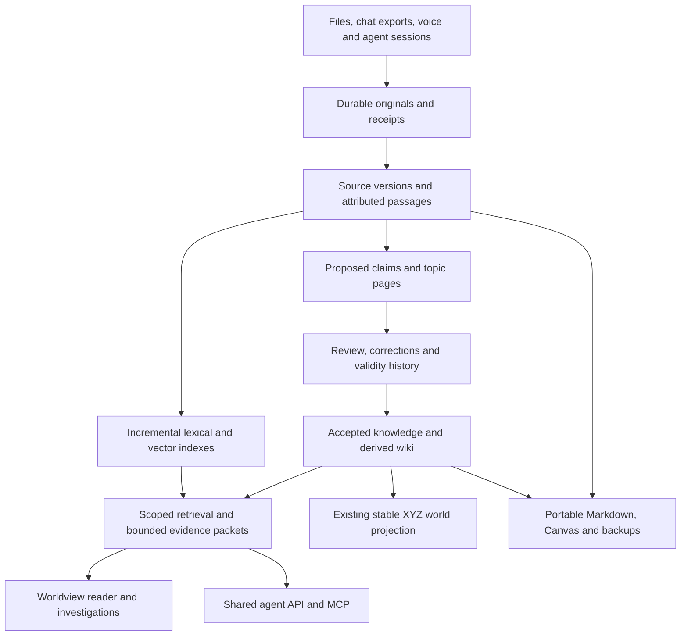

# Eight second-brain projects: what Worldview should take

Researched November 23, 2026. **All eight sources are downloaded, revision-pinned and inventoried: 24,047 tracked files, 447,852,926 bytes of working-tree content.** The downloads are source checkouts, including their tracked assets, not installed applications. Git LFS payloads, submodules, dependencies and model weights were not fetched. No upstream installer, agent skill, application or test was executed.

The recommended direction is to make Worldview the durable home of the user's knowledge, with a maintained synthesis layer and a shared agent interface. Take GBrain's evidence/history discipline, QMD's retrieval engineering, Karpathy's wiki-maintenance loop, Claude-Mem's bounded context packets, Basic Memory's inspectable Markdown graph, and Obsidian's interchange formats. Retain Worldview's originals, source versions, permissions and spatial world as the foundation.

This is a source-level study of the principal storage, ingest, retrieval, context, revision, deletion and integration paths, plus representative tests. Downloading 24,047 files is not a claim to have audited every line or proven every upstream feature in execution. The detailed reports distinguish code we inspected, upstream documentation claims and our proposed adaptations.

## What each project contributes

| Project | What makes it distinct | What Worldview needs from it | What to download/reuse | Important boundary |
| --- | --- | --- | --- | --- |
| [GBrain](https://github.com/garrytan/gbrain/tree/47512aa50fa2be1ab3af55bf60c242a11be76392) | Shared agent memory with fact provenance, validity, history, withdrawal and evidence assembly | A read interface shared by agents; evidence-linked claims that can change without erasing their history; withdrawal that survives reimport | MIT core patterns; isolated validity/fusion helpers are in our reuse kit | Whole engine uses Bun/Postgres or PGLite and is not a replacement for our Node/SQLite adapter. Vendored components have their own notices. |
| [Karpathy's LLM Wiki](https://gist.github.com/karpathy/442a6bf555914893e9891c11519de94f/ac46de1ad27f92b28ac95459c782c07f6b8c964a) | A workflow for accumulating synthesis between questions | Maintained topic/entity pages, saved useful answers, an index, change log and health checks | Downloaded idea file; implement our own conventions and contracts | A concept document, not an executable app or a personal data dump. No explicit license grant was found. |
| [Claude-Mem](https://github.com/thedotmack/claude-mem/tree/29bc1cdf32aca60b3bfeec3b718d4ed6614b4f97) | Capture of coding-session observations and selective context reinjection, now with multiple runtime/backend paths | Project/session-aware observations; compact context packets; search first and fetch detailed evidence only when needed | Apache-2.0 patterns and selected source references, retaining LICENSE and NOTICE | Its local hook path deliberately uses ephemeral content handoffs; its server path has canonical events/outbox durability. Neither replaces our raw-original ledger. |
| [Agent Second Brain](https://github.com/smixs/agent-second-brain/tree/7828ed62cf76aae87bee7f2660468ab88495cf3d) | A practical Telegram-to-vault personal assistant with capture, graph maintenance and routines | A voice/media inbox, explicit input identity, vault health and ambiguity-safe link resolution | MIT adapter/format patterns; study its operation and failure tests | Its voice path does not retain original audio before transcription. Worldview already has local Whisper. Do not copy its permission-bypass/TUI-driving deployment. |
| [Supermemory](https://github.com/supermemoryai/supermemory/tree/fa2af930dd78ba5504d7f35875d57f62084fdb5a) | Productized agent memory APIs, namespaces, profile context and source/memory relationships | A clear memory API, profile versus recent context, lifecycle/status reporting and explicit scope | Public MIT client/UI patterns; evaluate an API adapter only if an external service is chosen | Public repository is not the complete server engine. Its local binary is separately licensed and documents a 10,000-document lite limit. The bundled skill has a separate Apache license. |
| [Basic Memory](https://github.com/basicmachines-co/basic-memory/tree/506305b856967da1799f530502b6d9b7e6bd9610) | Human-editable Markdown as a durable knowledge surface with typed observations/relations and a file-backed graph | Readable exports, stable identity, explicit relations, incremental chunk identities and bounded graph expansion | Independently implement the format/architecture ideas; inspect the separately MIT OpenClaw adapter if useful | Current core declares AGPL-3.0-or-later. Its Hermes adapter is also AGPL; do not treat the entire checkout as permissive code. |
| [QMD](https://github.com/tobi/qmd/tree/8be0c42395c02ff73bce6d6c2e67d7905b0a771c) | Local-first Markdown retrieval with normalized storage, structured chunking, query expansion, fusion and bounded reranking | Incremental storage, better passage boundaries, retrieval explanations and a measured optional reranker | MIT source patterns and benchmark type reference; later compare through an isolated adapter | Native SQLite/llama.cpp and model runtime are not browser dependencies. Local is the default; explicit remote embedding/rerank options exist. Model licenses are separate. |
| [Obsidian Skills](https://github.com/obsidianmd/obsidian-skills/tree/b110b2f8e9eb1f287892f937050dfd40af862cbb) | Precise agent-facing references for Obsidian formats and tools | Correct Markdown properties, links/embeds/callouts, Canvas export and collection interchange | Three MIT format skills and references are copied into the inert reuse kit | Moved from `kepano` to `obsidianmd`. Seven skills, not a memory database. No skills were installed into our active agent configuration. |

Per-component licensing and source evidence are detailed in the reports below. Public visibility alone is not permission to redistribute source without a license; [GitHub's licensing documentation](https://docs.github.com/en/repositories/managing-your-repositorys-settings-and-features/customizing-your-repository/licensing-a-repository) explains that distinction. The actual pinned license files govern the code we selected.

## The architecture worth combining

These systems separate into four useful layers: capture, durable evidence, maintained understanding, and retrieval/context delivery. Most viral descriptions collapse those layers into the phrase “second brain.” Installing a search CLI or connecting a chatbot does not supply all four.

This is our proposed combination, not a diagram copied from an upstream project. There should be one authoritative corpus. Other indexes, agent packets and the 3D scene derive from it; they must not become separately editable copies that silently disagree.

Worldview already preserves originals, attributed passages, source history, explicit AI access, saved investigations, bounded organization jobs and real folder capture. The largest remaining structural gap is that the corpus authority is one revisioned JSON snapshot. The earlier 10,000-source measurement did not meet the proposed capture target reliably. Installing more agents around that snapshot would multiply serialization and reconciliation costs. Normalize incremental writes before adding expensive continuous synthesis.

## What this lets us do

**One memory across agents.** A coding assistant can ask what was decided in a research chat, retrieve only the authorized supporting passages, and return citations that open Worldview. Its session observation becomes a typed source with a project and author; it cannot silently rewrite a personal belief. Start with read-only interoperability and reviewable proposed writes.

**Research that accumulates.** A project about energy, entropy or another subject gains a maintained topic page supported by multiple sources. New evidence marks dependent sections stale. A proposed update shows the supporting and conflicting passages and preserves manual corrections. The result is reusable understanding, rather than another long answer buried in a chat.

**An explainable history of thinking.** “I preferred approach A, then switched to B after this experiment” becomes a claim revision with evidence, a recorded time and a validity interval. Reading an old date does not resurrect evidence that was later withdrawn or deleted. The existing world timeline still controls record births; content/claim history is an additional explicit view.

**A voice and media inbox.** Capture original bytes first, transcribe locally where supported, retain timestamps, then propose notes and relationships. Telegram can be an optional input adapter later. It should use our existing local Whisper path where appropriate; adding a second transcription vendor is not necessary to get the workflow.

**Portable investigations.** Export readable notes and source references, a `.canvas` map for an investigation, and a `.base` description of a collection. Keep Canvas's 2D layout separate from the 3D world's XYZ anchors. Interchange must retain UUIDs and report ambiguous links instead of connecting an arbitrary same-named note.

**A trustworthy assistant context.** Distinguish stable user-approved preferences, project context, recent events and retrieved evidence. Use a budget for the actual rendered packet, then progressively fetch detail. Show what was omitted or stale. Repeating an assistant summary must not increase the strength of its underlying evidence.

## What we should avoid copying

- GBrain's similarity-based update heuristic can conflate related statements; use similarity to propose candidates, then require an explicit relation such as replacement, disagreement or independent support. Its inspected decay formula also does not produce 50% weight at a parameter named half-life.
- QMD's short six-character docid is not a sufficiently strong citation identity for us. Keep source/version/passage UUIDs and verified offsets. Its inspected benchmark precision denominator and suffix matching should not become our evaluation definition.
- A generated hypothetical answer used to improve search is a retrieval aid, never evidence or a fact to store.
- Smixs's graph-density health score measures structure, not truth, and its voice/TUI operational assumptions should not be inherited by default.
- A Supermemory client clone does not give us the private extraction/reasoning engine. Its documented hosted capabilities and public code coverage must remain separate in any comparison.
- None of these downloads is the author's complete private mind or personal corpus. GBrain includes software, documentation and examples; cloning it does not import Garry Tan's knowledge into Worldview.

## Next implementation order

1. Establish a recorded retrieval/context evaluation baseline and add score explanations to existing search.
2. Replace whole-corpus snapshot commits with transactional source/version/passage/job deltas behind the existing interfaces; preserve backup and migration rollback.
3. Improve structural chunking and unify Obsidian link resolution with explicit ambiguity reporting.
4. Add a narrow shared memory read API and budgeted, source-linked context packets.
5. Pilot maintained topic pages, typed claims, revision history and durable withdrawal with review.
6. Add portable Markdown/Canvas/Bases export and a durable voice inbox. Compare optional QMD reranking only after the baseline is measurable.

The [integration plan](INTEGRATION-PLAN.md) specifies contracts, landing points, acceptance gates and the cases these features must handle. No application dependency or memory backend was replaced by this research task.

## Study files and downloads

- [Memory systems: GBrain, Basic Memory, Supermemory](memory-systems.md)
- [Retrieval and synthesis: QMD and LLM Wiki](retrieval-and-wiki.md)
- [Capture and interoperability: Claude-Mem, Agent Second Brain, Obsidian Skills](capture-and-skills.md)
- [Pinned download manifest](source-manifest.json), including every checkout revision and inventory hash
- [Selected reusable references and their licenses](reuse-kit/README.md)
- [Repeatable downloader](../../../../scripts/fetch-second-brain-sources.py)
- [Offline integrity and source-link verifier](../../../../scripts/verify-second-brain-research.py)

The local sources are under `data/research/second-brains/2026-11-23/sources/`, with per-file SHA-256 inventories beside them. They remain Git-ignored to avoid adding approximately 427 MiB of vendor content to the application repository. The research reports, pins, small reuse kit and downloader are ordinary project files. Re-running the downloader preserves existing checkouts and verifies their pinned identity; it does not pull or reset them.

Verification results are recorded in [verification.json](verification.json): all eight copies, 24,047 files, 19 kit files and 131 distinct pinned code links passed integrity/target checks. `npm run check` passed TypeScript, ESLint and all **927 tests across 142 files** after adding the research isolation rule. Its log is `/private/tmp/worldview-second-brain-check.log`. These application checks use only our own configured test tree; downloaded sources are excluded from ESLint. Upstream performance numbers and test claims are attributed to upstream documentation; no new upstream runtime benchmark or model-quality claim is made here.
